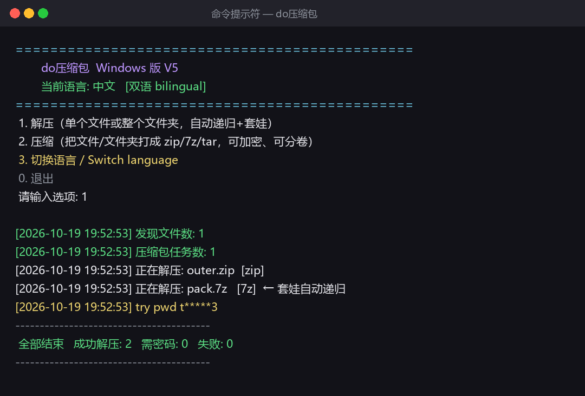
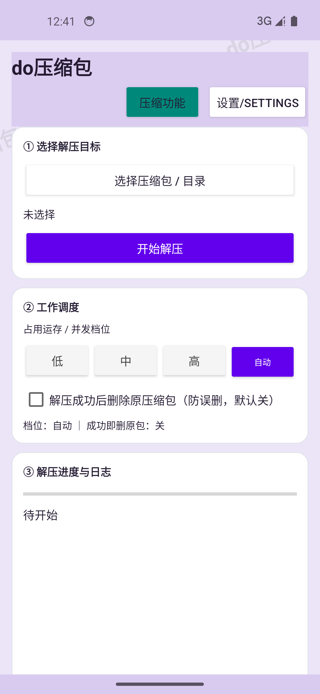
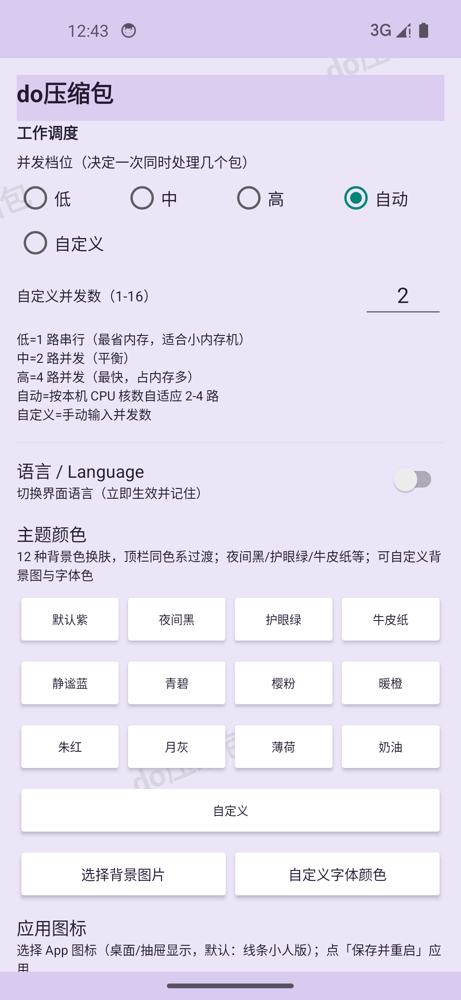

<div align="center">

# 📦 do压缩包 · do Archive Toolkit

**一个横跨 Windows 与 Android 的双语批量解压 / 压缩工具**
**A bilingual (中文 / English) batch extractor & archiver for Windows and Android**

[](#%E5%8D%8F%E8%AE%AE--license)
[](./windows)
[](./android)
[]()

</div>

> ⚠️ **本软件仅供个人学习与非商业用途 / For personal & non-commercial use only.**
> 严禁出售、付费分发或用于商业代解压服务。完整条款见 [`LICENSE`](./LICENSE)。
> It only wraps the CLIs of **7-Zip / LZ4 / WinRAR** and contains none of their proprietary source.

---

## ⬇️ 一键下载 / Quick Download

> 不用看源码？直接到 **[📦 Releases 发行页](../../releases/latest)** 按设备下载即可，开箱即用。

| 你的设备 | 推荐下载 | 说明 |
|---|---|---|
| 🖥️ **Windows 电脑**（最省事） | [**doArchive-Windows-portable.zip**](../../releases/latest/download/doArchive-Windows-portable.zip) | 免安装整包：解压即用，已含 7-Zip / lz4 |
| 🖥️ Windows（只要单文件） | [**doArchive.exe**](../../releases/latest/download/doArchive.exe) | 单可执行文件，放在任意目录运行 |
| 📱 **安卓手机**（Android 14–17） | [**doArchive-Android-v1.4.8.apk**](../../releases/latest/download/doArchive-Android-v1.4.8.apk) | 安装包，允许"未知来源"后直接安装 |

- Windows 装好后：解压整包 → 双击 `解压.bat` / `压缩.bat`，或直接运行 `doArchive.exe`；也可把压缩包**拖到 bat 上**。
- 安卓装好后：首次运行授予"文件"权限；**升级请覆盖安装**，密码与设置会保留。
- 所有文件均本地运行、无联网、无广告；Windows 若被 SmartScreen 拦截，选"仍要运行"（未做付费签名所致）。

---

## 🖼️ 界面预览 / Screenshots

<p align="center">
  
</p>

| 📱 Android 主界面 | 🎨 12 主题 / 调度 / 双语设置页 |
|:---:|:---:|
|  |  |

---

## 🌐 语言 / Language

- 中文说明：往下阅读本文件，平台细节见 [`docs/`](./docs)
- **English**: see [`README_EN.md`](./README_EN.md) and [`docs/`](./docs)

---

## ✨ 功能一览 / Features

### 🖥️ Windows 端（本仓库 V5，见 `windows/`）
- **解压 + 压缩双向**：解压 zip/7z/rar/tar/gz/bz2/xz/lz4；压缩 7z/zip/tar，可加密、可分卷
- **单文件 / 文件夹通吃**：拖一个包，或拖整个目录，都能识别
- **自动递归"套娃"**：解压后里面还有压缩包？自动接着解，直到没有为止
- **分卷智能识别**：`part1.rar`、`z01`、`zip.001`、`7z.001` 整组处理、整组删除
- **加密包密码池**：多个包共用密码时自动复用；逐包掩码输入，密码不明文上屏
- **结果扁平化**：解开的内容直接落在包旁边，不堆 20 层嵌套文件夹
- **可选成功后删除原包 / 原文件**（默认关闭，防误删）
- **双语**：中文 / English 一键切换
- **三种形态任选**：绿色 `.exe`（免装 Python）、`.bat + .py`（可读源码）、`.ps1`（PowerShell）
- 自带绿色版 **7-Zip** 与 **lz4**，多数机器解压即用、零配置

### 📱 Android 端（v1.4.8，见 `android/`）
- 批量解压 / 压缩、加密 zip(AES-256)/7z、分卷、套娃、密码本（加密本 / 解密本）
- 12 种主题全页面联动（含夜间黑、护眼、自定义背景 / 字体色）
- 工作调度低 / 中 / 高 / 自动 / 自定义并发
- 5 款内置应用图标可切换为桌面图标
- 详细 + 简略日志导出
- 已在 **Android 14 / 17，骁龙与天玑平台实测通过**

---

## 🚀 快速开始 / Quick Start

### Windows（30 秒上手）
1. 进入 [`windows/`](./windows) 文件夹；
2. **解压**：把文件或文件夹拖到 **`解压.bat`** 上；**或** 双击 **`do压缩包.exe`** 进菜单选 1；
3. **压缩**：双击 **`压缩.bat`**（或 exe 选 2），按提示选格式 / 密码 / 分卷；
4. 没有 Python 也没关系，直接用 **`do压缩包.exe`**。

> 不想用命令行？全程双击 + 拖拽即可。高级用法、虚拟机检验、环境搭建见
> [`docs/WINDOWS_使用教程.md`](./docs/WINDOWS_使用教程.md)（含图解 / with screenshots）。

### Android
1. 把 [`android/do压缩包_v1.4.8.apk`](./android/do压缩包_v1.4.8.apk) 传到手机，允许"安装未知来源应用"后安装；
2. 覆盖安装会保留已保存的密码与设置，无需重输。
3. 图文步骤、Android 14–17 权限说明见 [`docs/ANDROID_使用教程.md`](./docs/ANDROID_使用教程.md)。

---

## 📂 仓库结构 / Repository Layout

```
V5/
├─ README.md / README_EN.md     双语总说明（你正在看）
├─ LICENSE                      非商业开源协议（务必阅读）
├─ windows/                     Windows 端
│  ├─ do压缩包.exe               绿色单文件可执行（免装 Python）
│  ├─ do_extract.py             核心源码（解压+压缩+双语）
│  ├─ 解压.bat / 压缩.bat        拖拽/双击启动器
│  ├─ do.ps1                    PowerShell 版
│  └─ tools/                     自带绿色 7-Zip 与 lz4
├─ android/                     Android 端
│  ├─ do压缩包_v1.4.8.apk         安装包
│  └─ source/                   可编译的 Android Studio 工程源码
├─ docs/                        图文教程 / 构筑环境 / 实测报告 / 第三方下载
└─ assets/                      README 用图
```

---

## 🔧 实现方式 / How it works
- **Windows**：Python 3 标准库 + 调用 7-Zip、lz4（及本机 WinRAR）命令行；
  用"文件头魔数"识别真实格式（不依赖后缀，可识别伪装包）；`.exe` 由 PyInstaller 打包。
- **Android**：Kotlin 原生，libarchive / unrar 原生库（JNI）+ Room(SQLite) 密码库 + 前台 Service 批量任务。

详见 [`docs/实现原理.md`](./docs/实现原理.md)。

---

## 🔗 第三方工具官网 / Official downloads
本软件不含这些工具的专有代码，需要时请到官网获取：

| 工具 | 官网 | 用途 |
|---|---|---|
| **7-Zip** | https://www.7-zip.org | 主力解压/压缩（LGPL/BSD，免费） |
| **LZ4** | https://lz4.github.io/lz4/ · https://github.com/lz4/lz4 | .lz4 极快解压 |
| **WinRAR** | https://www.win-rar.com | 创建/处理 RAR（共享软件） |

---

## 📮 问题反馈 · 更新计划 · 合作 / Feedback · Roadmap · Contact

### 🐛 问题反馈 / Bug reports
遇到解不开的包、闪退、乱码、误判等问题，欢迎通过下面任一方式反馈，**附上日志与复现步骤**会修得更快：
- 推荐：在本仓库 [**Issues**](../../issues) 发帖（可直接贴截图 / 日志 txt，建议标注：Windows 还是 Android、系统版本、包格式如 zip/7z/rar、是否加密/分卷）。
- 邮件：**xiaoyaotongxue8@gmail.com**（不方便用 GitHub 时）。

> 日志在哪：Windows 为程序目录下的 `do_extract_log.txt`；Android 在主界面「③ 解压进度与日志」可导出详细/简略日志。

### 🧭 更新方向 / Roadmap（计划中，欢迎投票/提需求）
- [ ] Windows 图形界面（GUI）版本
- [ ] 更多压缩格式（如 zstd）与更多分卷命名规则
- [ ] Windows / Android 密码本互通（加密导出/导入）
- [ ] 更细的并发与内存档位、失败一键重试
- [ ] 更多语言（i18n 扩展）

需求与优先级以 Issues 反馈为准。

### 🤝 参与贡献 · 合作 / Contributing & collaboration
- 欢迎提 Issue、Pull Request（建议先开 Issue 讨论方案），提交即表示你同意以本项目的非商业协议开源你的改动。
- 技术交流、文档/翻译（尤其是其它语种）、真机兼容性测试（更多品牌/Android 版本）都非常欢迎。
- **非商业的开源协作 / 学习交流**可邮件联系：**xiaoyaotongxue8@gmail.com**。
  （来信请注明来意；任何形式的商业打包、转售、商业代解压合作均不在接受范围内。）

---

## ⚖️ 协议 / License
非商业开源，详见 [`LICENSE`](./LICENSE)。**禁止商用**；操作不可逆文件前请自行备份，作者不承担数据损失责任。
